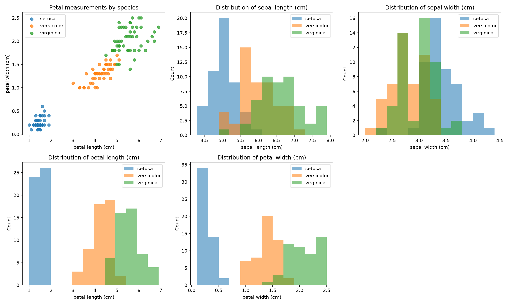
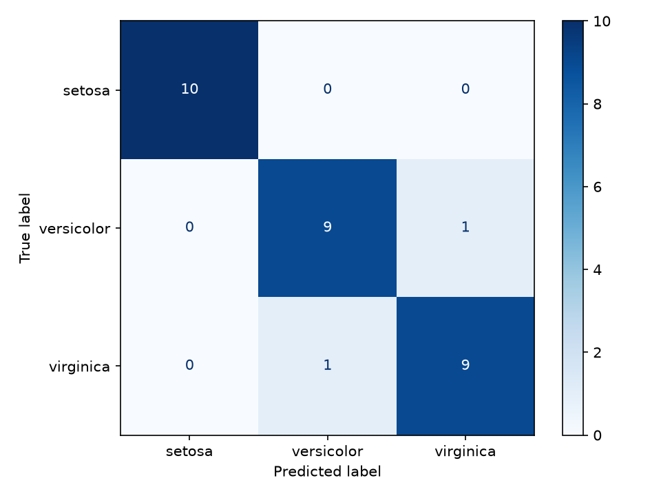

# Iris Flower Classification

A small, reproducible machine-learning project that classifies Iris flowers as
Setosa, Versicolor, or Virginica using their sepal and petal measurements.

## Dataset

The script uses the classic Iris dataset bundled with
[scikit-learn](https://scikit-learn.org/stable/datasets/toy_dataset.html#iris-dataset).
It contains 150 samples, four numeric features, and 50 samples per species.
No external dataset download is required.

## Method

- Explore the data with a petal-measurement scatter plot and histograms for all
  four features.
- Split the data into stratified training and test sets (80/20).
- Compare Logistic Regression, K-Nearest Neighbors, and Decision Tree models
  using stratified 5-fold cross-validation on the training set.
- Fit the best cross-validation model and evaluate it on the held-out test set
  with accuracy, a classification report, and a confusion matrix.

Feature scaling is included in the Logistic Regression and K-Nearest Neighbors
pipelines. The Decision Tree does not require scaling. The split and
cross-validation use fixed random seeds (`42`) so the results are reproducible.

## Results

Mean accuracy over 5 stratified cross-validation folds on the training data:

| Model | Mean CV accuracy |
| --- | ---: |
| Logistic Regression | 95.8% |
| K-Nearest Neighbors | 95.8% |
| Decision Tree | 95.0% |

Logistic Regression was selected (the first model in the comparison when the
top scores tie). It achieved **93.3% test accuracy (28 of 30 samples)**.
Setosa was classified correctly for all 10 test flowers. One Versicolor was
predicted as Virginica, and one Virginica was predicted as Versicolor.

The test set contains only 30 samples, so each incorrect prediction changes
accuracy by about 3.3 percentage points. Cross-validation helps compare models
without using the held-out test set for selection, but neither score guarantees
performance on new data.

## Requirements

- Python 3.11 or newer
- Packages listed in [`requirements.txt`](requirements.txt)

## Run

From the project directory, install the dependencies and run the script:

```powershell
python -m pip install -r requirements.txt
python iris_classification.py
```

On Windows, if `python` does not point to Python 3.11+, use the Python launcher:

```powershell
py -3.11 -m pip install -r requirements.txt
py -3.11 iris_classification.py
```

The script prints the dataset summary and evaluation metrics, then writes
`iris_exploration.png` and `iris_confusion_matrix.png` beside the script.

## Tests

Run the automated checks with Python's built-in test runner:

```powershell
python -m unittest -v
```

## Visualizations

### Exploratory plots



### Confusion matrix

Rows show actual species; columns show predicted species.


